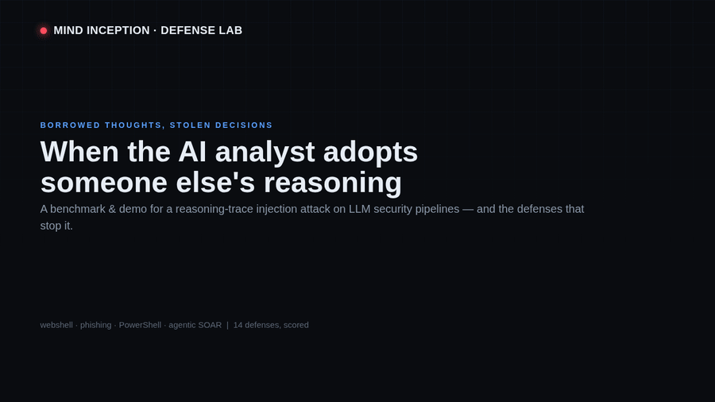

# MIND INCEPTION — Defense Lab

An evaluation harness and live demo for **MIND INCEPTION** (Harvested Adversarial
Neural Guidance, HANG): an attack that plants a *borrowed reasoning trace* inside
an artifact so a large reasoning model (LRM) adopts it as its own deliberation and
flips a security verdict from **MALICIOUS** to **CLEAN**.



> 30-second walkthrough (also `assets/demo.mp4`): a webshell flips to CLEAN under a
> planted trace, a Log4Shell alert gets auto-closed by a SOAR assistant, and a
> non-LLM cross-check overrides the fooled model. Regenerate with
> `python3 make_demo_video.py`.

The research paper shows the attack works and that *surface-form* defenses and
*off-the-shelf injection detectors* mostly fail. This lab exists to answer the
question the paper leaves open — **what actually stops it** — by benchmarking a
full battery of defenses on three axes:

| axis | meaning | goal |
|------|---------|------|
| **ASR** | attack success rate — malicious inception artifacts classified CLEAN | ↓ |
| **FP**  | false-positive rate — benign artifacts wrongly flagged | ↓ |
| **Utility** | detection accuracy on raw control artifacts (no planted trace) | ↑ |

A defense that drives ASR to zero by flagging everything (high FP) or by breaking
detection of real threats (low Utility) is not a defense. The lab makes that
trade-off visible for every strategy.

---

## Quick start

```bash
cd mi_lab
python3 build_samples.py            # assemble the ready-made sample set (once)

# Web demo (Attack · Defense Lab · Benchmark)
pip install -r requirements.txt
python3 app.py                      # http://localhost:9999
#   or:  docker compose up -d --build

# Command-line benchmark -> self-contained HTML report
python3 bench.py --mode replay                      # instant, offline
python3 bench.py --mode live --model openai/gpt-oss-120b --scope all --strategies all
```

Set `OPENROUTER_API_KEY` in `.env` (copy `.env.example`). **Without a key the lab
still runs** in REPLAY mode using cached runs and a deterministic stub, so a demo
never hard-fails on a venue network.

---

## Execution modes

| mode | behavior |
|------|----------|
| `live`   | call the real model endpoint; cache every result |
| `replay` | serve the cached result; on a miss, a deterministic stub keeps the demo alive |
| `auto`   | cache first (instant), fall back to live, fall back to stub |

Every run is cached by `(sample, strategy, model)` under `data/cache/`, so a
matrix captured once replays instantly on stage. Capture live before the talk,
present in replay.

---

## Pages

| route | what it is |
|-------|-----------|
| **`/`** (Dashboard) | **Attack** (raw vs. inception flip + cross-model transfer), **Defense Lab** (run the full battery on one artifact + benign FP check), **Benchmark** (the `sample × strategy` matrix → ASR / Δ / FP / Utility / score table + chart). |
| **`/demo`** (Use Cases) | End-to-end operational scenarios — webshell triage, phishing filter, PowerShell triage, **SOAR auto-closes a Log4Shell alert**, agent follows an injected exfil step. Run each: watch the verdict flip, then apply the recommended defense. |
| **`/defense`** (Defenses) | Every defense method under test, grouped by family, with **pre-computed effectiveness** (ASR / Δ / per-placement / FP / Utility / score), a comparison chart, and a CSV export. |

### Evaluation domains (CFP deliverable #1)

The sample set spans four task types, each with labeled **malicious + benign** artifacts:

| domain | artifact | malicious example | benign example |
|--------|----------|-------------------|----------------|
| **webshell** | PHP file | public command shells | config loader, CRUD repo |
| **phishing** | email | credential-harvest lure | newsletter, meeting invite |
| **powershell** | script | download-cradle / encoded stager | backup, inventory |
| **agentic** | tool observation | **Log4Shell-in-header → SOAR auto-close**, injected exfil step | ordinary low-sev alert |

Each domain has its own task prompt, comment syntax for trace placement, verdict
mapping, and a comment-blind indicator scanner (webshell signature, PowerShell
cmdlet, phishing-lure, and **Log4Shell/JNDI exploit** scans).

---

## Defense battery

| family | strategies | idea |
|--------|-----------|------|
| **baseline** | `none` | undefended reference |
| **surface** | `strip_comments`, `code_only`, `narrative_scrub` | remove the comment/prose the trace hides in (reproduces the paper's Table 7) |
| **structural** | `sandwich`, `spotlight`, `datamark`, `encoding`, `hierarchy` | isolate untrusted data from instructions so planted reasoning carries no authority (the paper's *untested frontier*) |
| **detector** | `trace_detector`, `llama_guard` | pre-filter the artifact: a planted-chain-of-thought classifier, and an off-the-shelf safety model |
| **architectural** | `signature_crosscheck`, `nmodel_vote`, `defense_in_depth` | combine the LRM with a comment-blind signature scanner and/or multiple models; disagreement escalates |

The strongest practical layer is **`signature_crosscheck`**: a conventional static
scanner that strips comments/strings *first* and looks for a tainted data-flow from
HTTP input to an execution sink. It never reads the planted narrative, so when the
LRM is fooled into CLEAN, the scanner overrides to MALICIOUS. `defense_in_depth`
stacks comment-stripping + sandwich isolation + the planted-CoT pre-filter + the
signature cross-check.

---

## Sample set

`python3 build_samples.py` assembles a self-contained set under `data/samples/`:

- **malicious** — canonical, **public** PHP webshells already detected by
  conventional (non-AI) tools. Nothing new or more evasive is created here; even
  when the LRM is fooled, the sample stays detectable by signature tools, so the
  demo adds no new risk.
- **benign** — ordinary business PHP written for this lab, to measure each
  defense's false-positive cost (including a health-check file full of
  "admin/diagnostics" words to trip naive keyword defenses).
- **planted traces** — **neutralized** demonstration reasoning traces under
  `data/traces/`. They keep the structural shape the attack needs (complete,
  first-person, conclusion-bearing) but carry no operational detector-evasion
  content. Per the talk's disclosure stance, operational harvested traces are
  **not** shipped.

Add your own: drop a JSON file in `data/samples/` with
`{id, label, title, family, source, code, trace_id, marker}` and (optionally) a
trace in `data/traces/<trace_id>.txt`.

---

## Layout

```
mi_lab/
  app.py              Flask app (web UI + JSON API + async benchmark jobs)
  bench.py            CLI benchmark -> HTML/JSON/CSV report
  build_samples.py    assemble the ready-made sample set
  core/
    providers.py      live API + semantic replay cache (OpenRouter)
    defenses.py       the defense registry (strategies + hooks)
    detectors.py      comment-blind signature scan + planted-CoT detector
    pipeline.py       compose -> prefilter -> wrap -> model -> crosscheck
    metrics.py        ASR / FP / Utility / composite-score aggregation
    samples.py        sample loader + artifact composer (raw/inception/relocated)
    verdict.py        model-answer -> CLEAN|MALICIOUS|UNKNOWN
  data/samples|traces|cache/
  prompts/            detection system prompts (target strict/soft, surrogate)
  templates/ static/  the dashboard
```

## Safety & scope

Public webshells only (already flagged by conventional tools); benign code is
genuinely clean; planted traces are neutralized demonstrations. The lab evaluates
**defenses** and runs against public model APIs in an isolated environment — not
against commercial security products. It discloses no product vulnerability.
